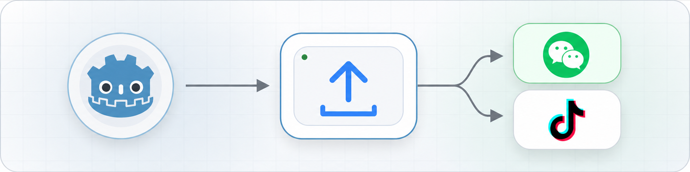
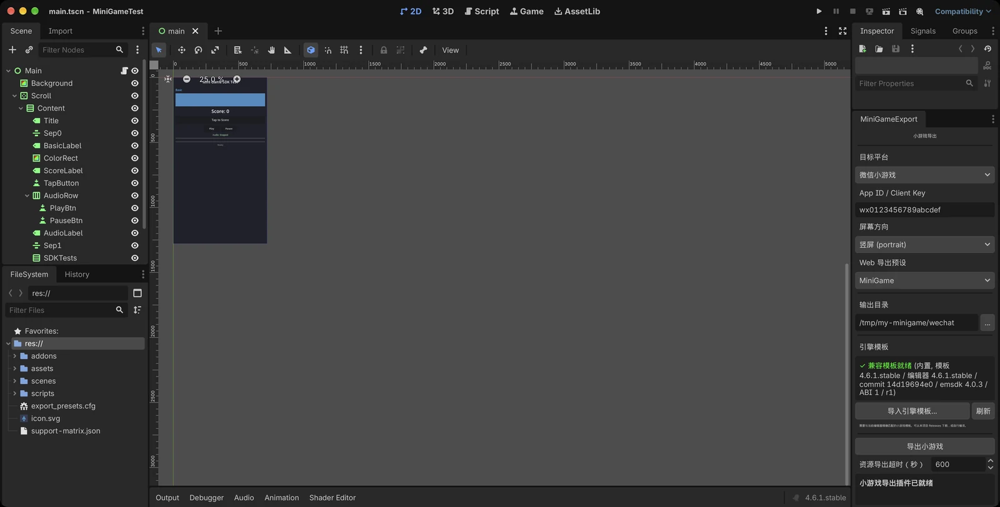
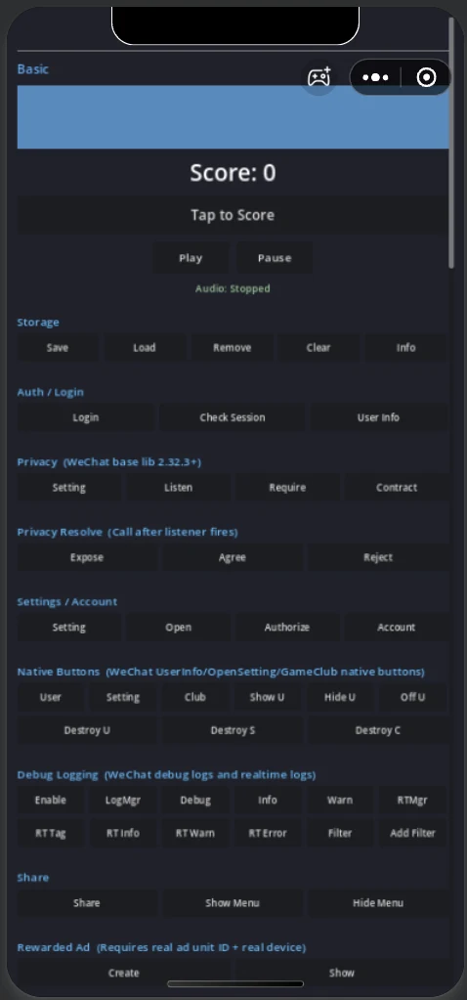
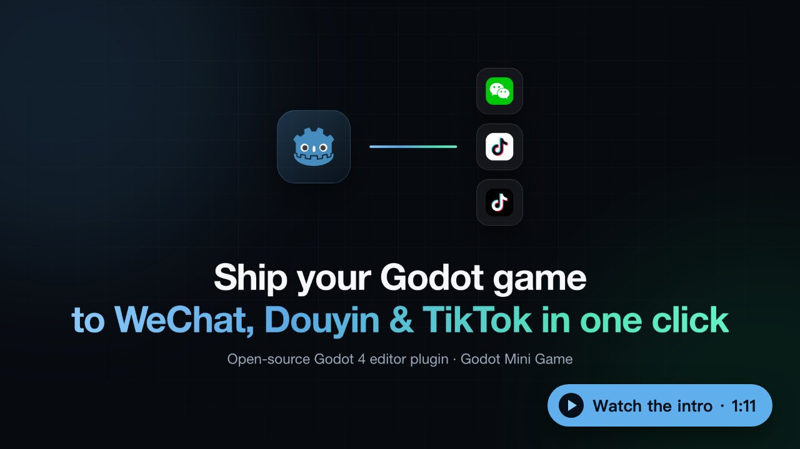
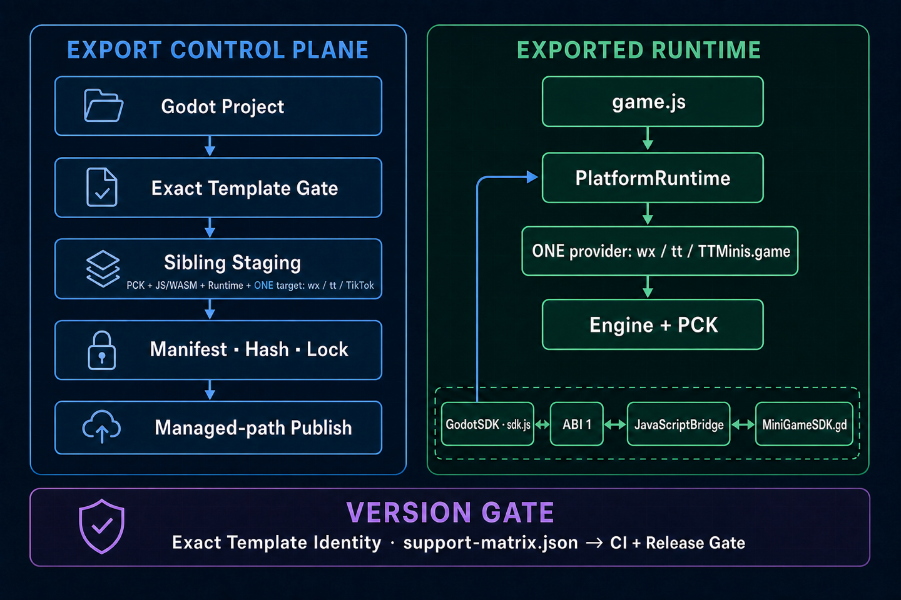

<p align="center">
  <picture>
    <source media="(prefers-color-scheme: dark)" srcset="assets/banner-dark-v2.png" />
    
  </picture>
</p>

<h1 align="center">Godot Mini Game</h1>

<p align="center">
  <strong>Export Godot games to WeChat, Douyin, and TikTok Mini Games in one click, from inside the editor.</strong>
</p>

<p align="center">
  <a href="https://github.com/AnranS/godot_for_minigame/releases/latest"></a>
  <a href="https://github.com/AnranS/godot_for_minigame/actions/workflows/smoke-test-export.yml"></a>
  
  <a href="LICENSE"></a>
</p>

<p align="center">
  <strong><a href="https://github.com/AnranS/godot_for_minigame/releases/latest">Download v0.3.1</a></strong> ·
  <a href="https://anrans.github.io/godot_for_minigame/quick-start/">Quick start</a> ·
  <a href="https://anrans.github.io/godot_for_minigame/guide/">Integration guide</a> ·
  <a href="https://anrans.github.io/godot_for_minigame/api/">API reference</a> ·
  <a href="https://github.com/AnranS/godot_for_minigame/releases/tag/promo-video-1">Intro video</a> ·
  <a href="README_zh.md">简体中文</a>
</p>

<table>
  <tr>
    <td align="center" width="25%"><h3>0 extra tools</h3><sub>No Node.js, Emscripten, Brotli, or Godot Web export templates to install</sub></td>
    <td align="center" width="25%"><h3>3 platforms</h3><sub>WeChat, Douyin, and TikTok from the same Godot project</sub></td>
    <td align="center" width="25%"><h3>225 SDK methods</h3><sub>Plus 84 signals, each checked against the host before it runs</sub></td>
    <td align="center" width="25%"><h3>3 Godot versions</h3><sub>4.6.1 · 4.6.3 · 4.7.2, each with an exactly matched engine</sub></td>
  </tr>
</table>

<p align="center">
  
  
</p>
<p align="center"><sub>Export from the Mini Game Export dock (left), then run the result in the platform DevTools (right). Real screenshots.</sub></p>

<p align="center">
  <a href="https://github.com/AnranS/godot_for_minigame/releases/tag/promo-video-1"></a>
</p>

## Highlights

<table>
  <tr>
    <td width="50%" valign="top">
      <h3>One-click export</h3>
      <p>Pick a platform in the Mini Game Export dock, enter the App ID, and export. The plugin writes the
      resource pack, engine, JavaScript adapters, and <code>game.json</code> into a folder the platform
      DevTools open directly.</p>
    </td>
    <td width="50%" valign="top">
      <h3>An engine that runs on devices</h3>
      <p>Standard Web templates rely on SIMD, WASM exceptions, and threads, which mini-game WebAssembly on
      real devices does not support. The bundled single-threaded WebGL 2 engine leaves them out and is
      patched for each host at export time.</p>
    </td>
  </tr>
  <tr>
    <td width="50%" valign="top">
      <h3>One SDK for three hosts</h3>
      <p><code>MiniGameSDK</code> offers 225 methods and 84 signals over <code>wx</code>, <code>tt</code>,
      and <code>TTMinis.game</code>. It checks what each host supports before calling it and stays safe
      to call while you develop in the editor.</p>
    </td>
    <td width="50%" valign="top">
      <h3>Safe re-exports</h3>
      <p>Every file is built and validated in a staging folder first. Only paths the plugin owns are
      replaced, so your other files in the output folder are kept.</p>
    </td>
  </tr>
</table>

## Supported Godot versions

Each engine template matches exactly one Godot editor. If the version, commit, or toolchain differs,
the export stops at preflight instead of failing at runtime.

| Godot editor | Source commit | Engine template |
|---|---|---|
| **`4.7.2.stable`** (latest) | `ed1daf0bf001` | One-click download in the dock ([release](https://github.com/AnranS/godot_for_minigame/releases/tag/template-4.7.2-stable-emsdk-4.0.3-2d-full-release-abi-1-r1)) |
| `4.6.3.stable` (official editor) | `35e80b3a8822` | One-click download in the dock ([release](https://github.com/AnranS/godot_for_minigame/releases/tag/template-4.6.3-stable-emsdk-4.0.3-2d-full-release-abi-1-r1)) |
| `4.6.1.stable` | `14d19694e0c8` | Bundled with the plugin |

CI exports every certified version to all three platforms. Plugin `v0.3.1` ·
Emscripten `4.0.3` · build `2d_full` · `release` · revision `1` · Bridge ABI `1` ·
template schema `1` · output schema `1`. [`support-matrix.json`](support-matrix.json) is the source
of truth for these values in releases, CI, and the website.

> [!TIP]
> Using another Godot version? Build a template for that exact version; see
> [custom templates](docs/USAGE.md#12-building-a-custom-engine-template).

## Platforms

| Platform | Runtime API | `game.json` subpackage field | Status |
|---|---|---|---|
| WeChat Mini Game | `wx` | `subpackages` | ✅ Supported |
| Douyin Mini Game | `tt` | `subPackages` | ✅ Supported |
| TikTok Mini Game Native | `TTMinis.game` | `subpackages` | 🧪 Beta — TikTok 43.4.0+; every release needs a `ttmg` compile and a real-device run |

> [!IMPORTANT]
> Automated checks do not replace testing in the platform DevTools and on real devices.

## Quick start

1. **Install.** Download `godot_mini_game_vX.Y.Z.zip` from the
   [latest release](https://github.com/AnranS/godot_for_minigame/releases/latest)
   **Assets** (not GitHub's source archive) and extract it into your project root,
   so you get `addons/godot_mini_game/`.
2. **Enable.** Turn on **Godot Mini Game Export** in
   **Project > Project Settings > Plugins**.
3. **Add a Web preset.** In **Project > Export**, add a **Web** preset with any
   name. The standard Web export templates are not needed.
4. **Export.** In the **Mini Game Export** dock, choose a platform, enter the App
   ID (TikTok: Client Key), an orientation, the Web preset, and an empty output
   folder outside the project, then click **Export**.
5. **Run.** Open the folder in WeChat or Douyin DevTools. For TikTok, run
   `ttmg setup` and `ttmg login` once, then `ttmg init` in the export folder with
   the same Client Key and `ttmg dev`; skipping `ttmg init` fails with
   `Missing clientKey`.

**[Step-by-step guide with screenshots →](https://anrans.github.io/godot_for_minigame/quick-start/)**

<details>
<summary>Install from source for development</summary>

```bash
git clone https://github.com/AnranS/godot_for_minigame.git
mkdir -p your_project/addons
cp -R godot_for_minigame/addons/godot_mini_game your_project/addons/godot_mini_game
```

</details>

## SDK in 60 seconds

`MiniGameSDK` is registered as an Autoload. Async calls report through signals,
and every method is safe to call while you develop outside a mini-game host.

```gdscript
MiniGameSDK.login_completed.connect(func(code: String, error: String) -> void:
    if error.is_empty():
        print("login code: ", code)
)
MiniGameSDK.login()

MiniGameSDK.storage_set("level", "5")
var level := MiniGameSDK.storage_get("level", "1")
MiniGameSDK.show_toast("Level %s" % level, "success")
```

**[Browse all 225 methods and 84 signals →](https://anrans.github.io/godot_for_minigame/api/)**
The reference lists the whole bridge; it is not a promise that every method
works on every host. Shared names are capability-checked, and payments and
other host-specific features use explicit per-platform mappings.

## Known limitations

- The engine is single-threaded: no `Thread`, GDExtension, C#, or WebRTC.
- Mini-game hosts have no system fonts: set and subset a [CJK font](docs/USAGE.md#cjk-fonts) if the game shows Chinese, Japanese, or Korean text.
- WeChat and Douyin currently render at 1× logical pixels, so high-DPI screens look slightly soft.
- Each export produces one resource pack; splitting game resources into custom subpackages is not supported yet.
- TikTok beta restores `user://` at startup but does not write it back, and fails closed for storage enumeration, battery reads, and public file-system writes. Use `storage_set()` / `storage_get()` for saves; see the [usage guide](docs/USAGE.md#file-system).
- TikTok beta keeps Godot's audio mixer off, so `AudioStreamGenerator`, Stream-mode playback, and bus effects are silent there; play sounds through `MiniGameSDK`'s InnerAudio API.

The [integration guide](https://anrans.github.io/godot_for_minigame/guide/) has
the full compatibility table.

## Documentation

| I want to… | Read |
|---|---|
| Export my first game | [Quick start](https://anrans.github.io/godot_for_minigame/quick-start/) |
| Check compatibility and release requirements | [Integration guide](https://anrans.github.io/godot_for_minigame/guide/) |
| Configure every option in detail | [Usage guide](docs/USAGE.md) |
| Find an SDK method or signal | [API reference](https://anrans.github.io/godot_for_minigame/api/) |
| Build or import another engine template | [Custom templates](docs/USAGE.md#12-building-a-custom-engine-template) |
| Understand export transactions and versioning | [Architecture](docs/ARCHITECTURE.md) |
| Publish a new plugin version | [Release process](docs/RELEASING.md) |
| Report a problem or request a feature | [GitHub Issues](https://github.com/AnranS/godot_for_minigame/issues) |

<details>
<summary>How it works</summary>

<p align="center">
  <a href="assets/export-architecture-v3.png">
    <picture>
      <source media="(max-width: 600px)" srcset="assets/export-architecture-mobile-v3.png" />
      
    </picture>
  </a>
</p>

- **Export** — each transaction selects WeChat, Douyin, or TikTok Native, resolves one complete engine bundle, assembles outside the destination, validates every managed artifact, and publishes under a lock.
- **Runtime** — `game.js` selects exactly one `PlatformRuntime` provider; the loader starts the patched engine and PCK, while `GodotSDK` and `MiniGameSDK` negotiate the Bridge ABI.

Publishing rolls back in-process failures and records recovery evidence, but it
is not a filesystem-wide crash-atomic primitive. See
[Architecture and versioning](docs/ARCHITECTURE.md).

</details>

## Contributing

Issues and pull requests are welcome. Keep platform-specific behavior behind the
shared runtime and bridge contracts, and run `./scripts/test.sh` (Node.js 22+ and
the matching Godot editor; set `GODOT_BIN` if needed) before submitting.
Maintainers follow the immutable [release process](docs/RELEASING.md).

## License

[MIT](LICENSE). The bundled Godot engine keeps its upstream notices; see
[`GODOT_COPYRIGHT.txt`](addons/godot_mini_game/GODOT_COPYRIGHT.txt) and
[`THIRD_PARTY_NOTICES.md`](addons/godot_mini_game/THIRD_PARTY_NOTICES.md).

## Star History

<p align="center">
  <a href="https://www.star-history.com/#AnranS/godot_for_minigame&Date">
    <picture>
      <source media="(prefers-color-scheme: dark)" srcset="https://api.star-history.com/svg?repos=anrans/godot_for_minigame&type=Date&theme=dark" />
      
    </picture>
  </a>
</p>
