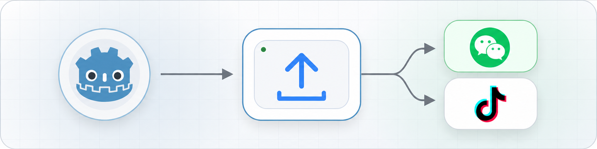
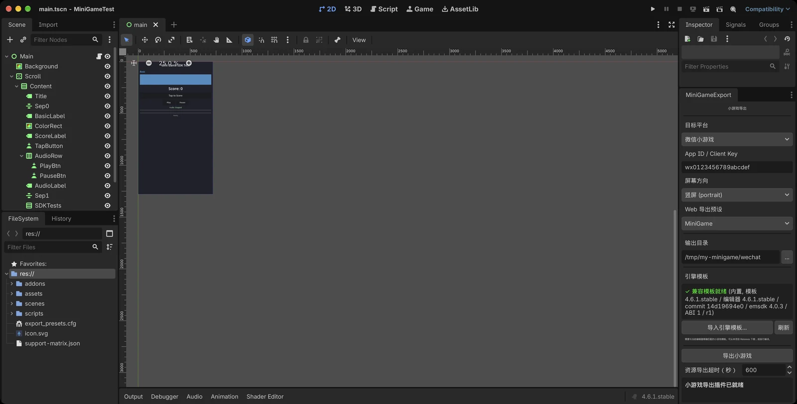
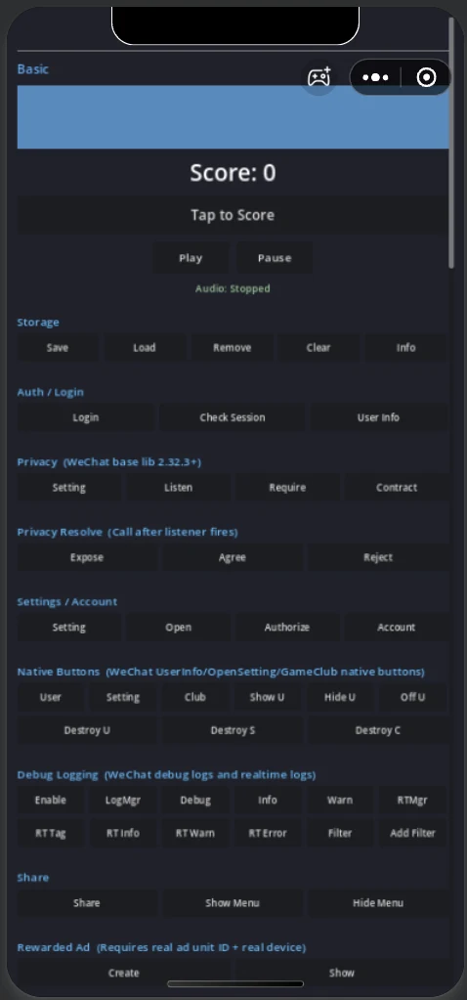
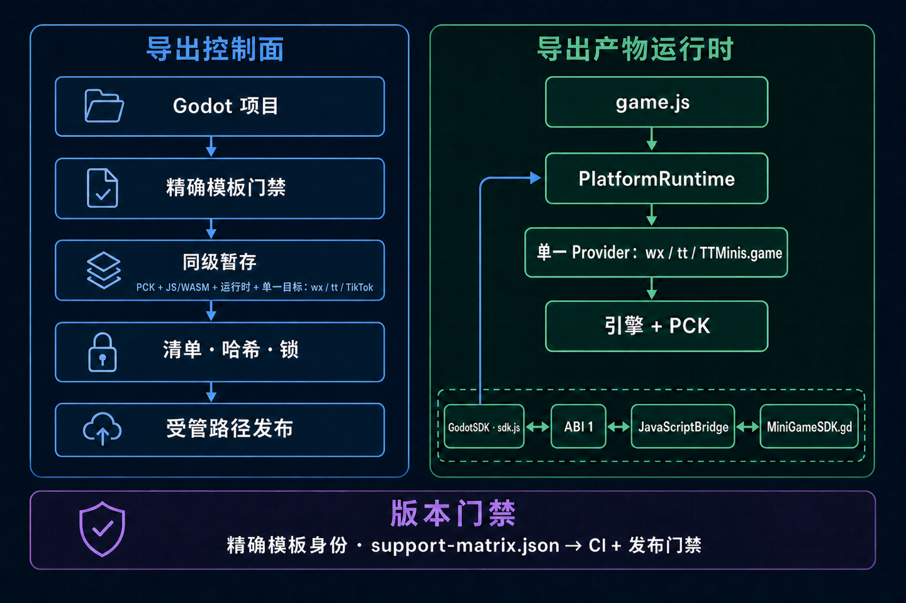

<p align="center">
  <picture>
    <source media="(prefers-color-scheme: dark)" srcset="assets/banner-dark-v2.png" />
    
  </picture>
</p>

<h1 align="center">Godot Mini Game</h1>

<p align="center">
  <strong>在 Godot 编辑器里，把游戏导出为微信、抖音与 TikTok 小游戏。</strong>
</p>

<p align="center">
  <a href="https://github.com/AnranS/godot_for_minigame/releases/latest"></a>
  <a href="https://github.com/AnranS/godot_for_minigame/actions/workflows/smoke-test-export.yml"></a>
  
  <a href="LICENSE"></a>
</p>

<p align="center">
  <strong><a href="https://github.com/AnranS/godot_for_minigame/releases/latest">下载</a></strong> ·
  <a href="https://anrans.github.io/godot_for_minigame/quick-start/">快速开始</a> ·
  <a href="https://anrans.github.io/godot_for_minigame/guide/">接入指引</a> ·
  <a href="https://anrans.github.io/godot_for_minigame/api/">API 文档</a> ·
  <a href="README.md">English</a>
</p>

<p align="center">
  
  
</p>
<p align="center"><sub>在小游戏导出面板中导出（左），再用平台开发者工具运行（右）。</sub></p>

## 特性

- **一键导出**：在小游戏导出面板中选择平台即可导出，不需要安装 Node.js、Emscripten、Brotli，也不需要下载 Godot Web 导出模板。
- **面向小游戏的引擎**：单线程、WebGL 2 的 Godot 构建，与验证过的编辑器版本精确对应。
- **一套 SDK 覆盖三个宿主**：`MiniGameSDK` 通过 `wx`、`tt` 与 `TTMinis.game` 提供 225 个方法、84 个信号，调用前会检查当前宿主是否支持。
- **安全的重复导出**：先在暂存目录生成并校验全部文件，只替换插件管理的路径，输出目录里的其它文件原样保留。

## 平台与版本

| 平台 | 运行时 API | `game.json` 分包字段 | 状态 |
|---|---|---|---|
| 微信小游戏 | `wx` | `subpackages` | ✅ 支持 |
| 抖音小游戏 | `tt` | `subPackages` | ✅ 支持 |
| TikTok Mini Game Native | `TTMinis.game` | `subpackages` | 🧪 Beta：需要 TikTok 43.4.0+，每次发布前都要通过 `ttmg` 编译与真机验证 |

| Godot 编辑器 | 引擎模板 |
|---|---|
| `4.6.1.stable` · commit `14d19694e0c8` | 随插件内置 |
| `4.6.3.stable`（官方编辑器） | [模板 Release](https://github.com/AnranS/godot_for_minigame/releases/tag/template-4.6.3-stable-emsdk-4.0.3-2d-full-release-abi-1-r1)，在导出面板中导入 |
| `4.7.2.stable` | [模板 Release](https://github.com/AnranS/godot_for_minigame/releases/tag/template-4.7.2-stable-emsdk-4.0.3-2d-full-release-abi-1-r1)，在导出面板中导入 |

插件 `v0.3.0` · Emscripten `4.0.3` · 构建 `2d_full` · `release` · revision `1` ·
Bridge ABI `1` · template schema `1` · output schema `1`。
[`support-matrix.json`](support-matrix.json) 是 Release、CI 与官网中这些数值的唯一事实源。

> [!NOTE]
> 其它 Godot 版本需要为该精确版本构建模板，见
> [自定义模板](docs/USAGE_zh.md#12-编译自定义引擎模板)。
> 自动化检查不能替代平台开发者工具和真机上的验收。

## 快速开始

1. **安装**：从[最新版本](https://github.com/AnranS/godot_for_minigame/releases/latest)的
   **Assets** 下载 `godot_mini_game_vX.Y.Z.zip`（不要下载 GitHub 自动生成的源码压缩包），
   解压到项目根目录，得到 `addons/godot_mini_game/`。
2. **启用**：在 **项目 > 项目设置 > 插件** 中启用 **Godot Mini Game Export**。
3. **添加 Web 预设**：在 **项目 > 导出** 中添加一个 **Web** 预设，名称随意，不需要下载
   标准 Web 导出模板。
4. **导出**：在 **Mini Game Export** 面板中选择平台，填写 App ID（TikTok 填 Client Key）、
   屏幕方向、Web 预设，以及项目之外的一个空输出目录，然后点 **导出**。
5. **运行**：用微信或抖音开发者工具打开输出目录。TikTok 先运行一次 `ttmg setup` 与
   `ttmg login`，再在导出目录用同一个 Client Key 运行 `ttmg init` 和 `ttmg dev`；跳过
   `ttmg init` 会报 `Missing clientKey`。

**[带截图的分步教程 →](https://anrans.github.io/godot_for_minigame/quick-start/)**

<details>
<summary>从源码安装，用于开发调试</summary>

```bash
git clone https://github.com/AnranS/godot_for_minigame.git
mkdir -p your_project/addons
cp -R godot_for_minigame/addons/godot_mini_game your_project/addons/godot_mini_game
```

</details>

## 60 秒上手 SDK

插件会将 `MiniGameSDK` 注册为 Autoload。异步接口通过信号返回；在小游戏宿主之外开发时，
调用任何方法也都是安全的。

```gdscript
MiniGameSDK.login_completed.connect(func(code: String, error: String) -> void:
    if error.is_empty():
        print("login code: ", code)
)
MiniGameSDK.login()

MiniGameSDK.storage_set("level", "5")
var level := MiniGameSDK.storage_get("level", "1")
MiniGameSDK.show_toast("Level %s" % level, "success")
```

**[查看全部 225 个方法、84 个信号 →](https://anrans.github.io/godot_for_minigame/api/)**
API 页面列出的是完整的桥接接口，不代表每个宿主都支持全部方法。同名能力会先检查宿主
是否支持，支付等平台特有能力按平台分别映射。

## 已知限制

- 引擎是单线程构建：不支持 `Thread`、GDExtension、C# 和 WebRTC。
- 微信和抖音目前按 1 倍逻辑像素渲染，高分屏上会略显模糊。
- 每次导出只生成一个资源包，暂不支持把游戏资源拆成多个自定义分包。
- TikTok beta 启动时恢复 `user://`，但不会写回；存储枚举、电池读取与公开文件系统写入会
  失败关闭。存档请用 `storage_set()` / `storage_get()`，详见[使用指南](docs/USAGE_zh.md#文件系统)。

完整的兼容性对照见[接入指引](https://anrans.github.io/godot_for_minigame/guide/)。

## 文档导航

| 我想要…… | 文档 |
|---|---|
| 导出第一个游戏 | [快速开始](https://anrans.github.io/godot_for_minigame/quick-start/) |
| 查看兼容性与发布要求 | [接入指引](https://anrans.github.io/godot_for_minigame/guide/) |
| 了解每个选项的详细用法 | [使用指南](docs/USAGE_zh.md) |
| 查找 SDK 方法或信号 | [API 文档](https://anrans.github.io/godot_for_minigame/api/) |
| 构建或导入其它版本的引擎模板 | [自定义模板](docs/USAGE_zh.md#12-编译自定义引擎模板) |
| 理解导出事务与版本管理 | [架构与版本管理](docs/ARCHITECTURE.md) |
| 发布新的插件版本 | [发布流程](docs/RELEASING.md) |
| 报告问题或提出功能建议 | [GitHub Issues](https://github.com/AnranS/godot_for_minigame/issues) |

<details>
<summary>工作原理</summary>

<p align="center">
  <a href="assets/export-architecture-zh-v3.png">
    <picture>
      <source media="(max-width: 600px)" srcset="assets/export-architecture-zh-mobile-v3.png" />
      
    </picture>
  </a>
</p>

- **导出**：每次事务只选择微信、抖音或 TikTok Native 之一，解析一个完整引擎模板包，在目标目录之外装配，验证所有受管产物，再在锁内发布。
- **运行时**：`game.js` 只选择一个 `PlatformRuntime` Provider；Loader 启动修补后的引擎与 PCK，`GodotSDK` 和 `MiniGameSDK` 协商 Bridge ABI。

发布过程支持进程内失败回滚并记录恢复证据，但它不是跨文件系统的 crash-atomic 原语。
完整边界见[架构与版本管理](docs/ARCHITECTURE.md)。

</details>

## 参与贡献

欢迎提交 Issue 和 Pull Request。平台差异应保持在共享 Runtime 与 Bridge 契约之后；提交前
请运行 `./scripts/test.sh`（需要 Node.js 22+ 和匹配版本的 Godot，必要时设置 `GODOT_BIN`）。
维护者请遵循不可变 Tag 的[发布流程](docs/RELEASING.md)。

## 许可证

[MIT](LICENSE)。内置 Godot 引擎保留上游版权声明，详见
[`GODOT_COPYRIGHT.txt`](addons/godot_mini_game/GODOT_COPYRIGHT.txt) 和
[`THIRD_PARTY_NOTICES.md`](addons/godot_mini_game/THIRD_PARTY_NOTICES.md)。
